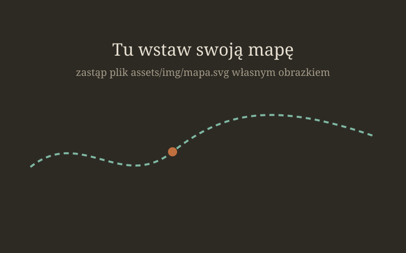

## Streszczenie

Oddział wyruszył z obozu po łupy i… (to jest przykład, usuń ten plik).

## Co się wydarzyło

- Pierwsze starcie przy ruinach.
- Znaleziono fragment receptury na antidotum.

> Cytat z sesji, który zostanie zapamiętany.
